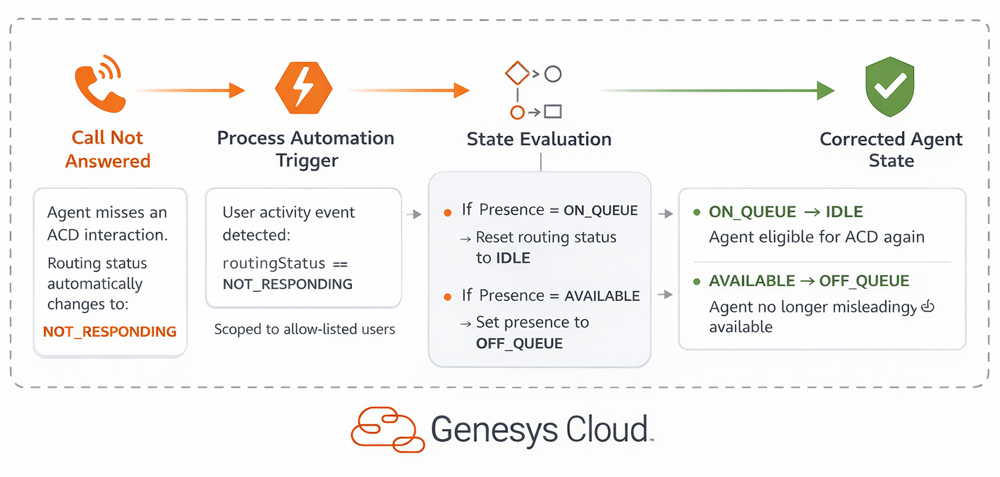

# Setup a Genesys Cloud Associate User

This Genesys Cloud Developer Blueprint explains how to set up a Genesys Cloud Associate User.  Specifically, maintain a mobile user's routing status when they go into a Not Responding routing status.

This GitHub repo contains the files required to configure this blueprint.  Full instructions can be found in the [Genesys Cloud Developer Center](https://developer.genesys.cloud/blueprints/).

